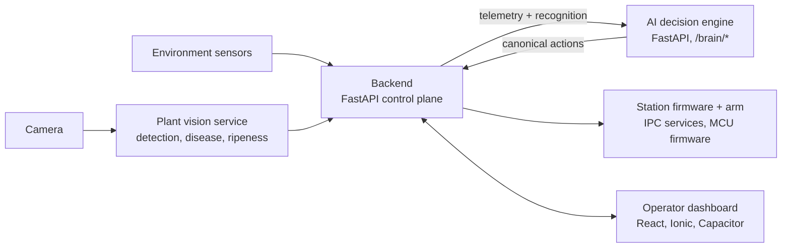

# GardenStation

An indoor hydroponic growing station that watches its own plants, decides what to do next and moves a robotic arm to do it, under the supervision of a human operator.

> **This repository is a public overview.** The source code of the individual services lives in private repositories of the
> [AutomatedAIGardenStation](https://github.com/AutomatedAIGardenStation) organisation. Everything below describes how the system is put
> together and what each part is responsible for.

## What it does

* grows plants on a fixed set of grow sites (the number is configurable) and keeps the nutrient reservoir within range;
* looks at the plants with a camera and recognises what it sees: detection, disease signs and ripeness;
* decides the next useful action (correct nutrient chemistry, inspect a site, harvest, flush, adjust light and climate) and refuses to act
  when a safety rule says no (fault, leak, low pressure, empty tank, stale critical sensor);
* executes the action on real hardware through a robotic arm and actuators;
* gives an operator one dashboard to monitor and control the station.

## Architecture

| Part | Responsibility | Stack |
|---|---|---|
| **Backend** | Control plane: REST + WebSocket API, sensor history, arm and environment control, calls the decision engine | Python, FastAPI |
| **AI decision engine** | Stateless per request. Takes telemetry and recognition output, predicts the next intent, applies policy and safety gates, returns canonical hardware actions. Never touches hardware itself | Python, FastAPI |
| **Plant vision service** | Detection, disease and ripeness assessment from camera frames | Python, YOLO-based models |
| **Operator dashboard** | Live state, next scheduled work and queue (a "Now / Next / Queue" model), manual control | React, Ionic, Capacitor |
| **Station and arm firmware** | Sensor hub, pumps and the robotic arm; simulation-first so that logic can be tested without hardware | Python IPC services, microcontroller firmware |
| **Hardware models** | CAD source of truth: assemblies, printed parts, drawings | STEP, STL, DWG |
| **Public site and docs** | Product overview and a documentation portal | Next.js |
| **Pipeline orchestrator** | One CI/CD orchestration across all repositories | GitHub Actions |

## Design principles

* **The brain decides, the backend executes.** The decision engine returns a list of canonical actions; only the backend talks to hardware,
  owns retries and exposes operator control.
* **Safety first.** Faults, leaks, pressure and stale sensors escalate before any optimisation. AI-started runs happen only inside an
  operator supervision window.
* **Simulation first.** Every hardware-facing service has a simulated transport, so behaviour is tested before it touches a pump or an arm.
* **One source of truth.** A locked decisions registry outranks every other page of the documentation, and each document has one canonical owner.
* **Data hygiene.** Training datasets are never committed to code repositories; models are restored from a manifest.

## About

Designed and built by [Ilian Damirov](https://kingegame.github.io/): system architecture, the services, the dashboard and the delivery pipeline.
